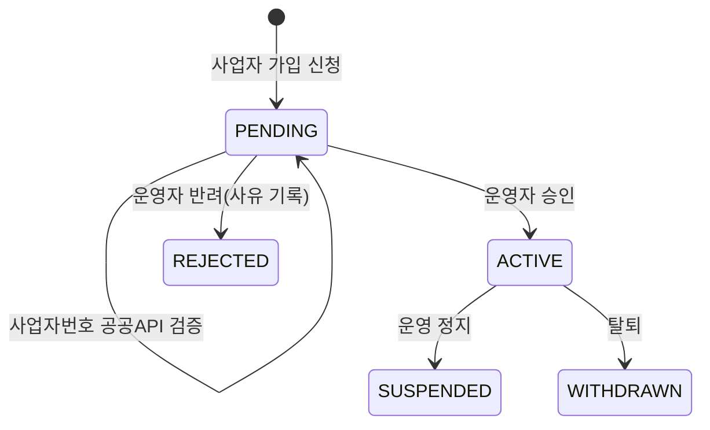
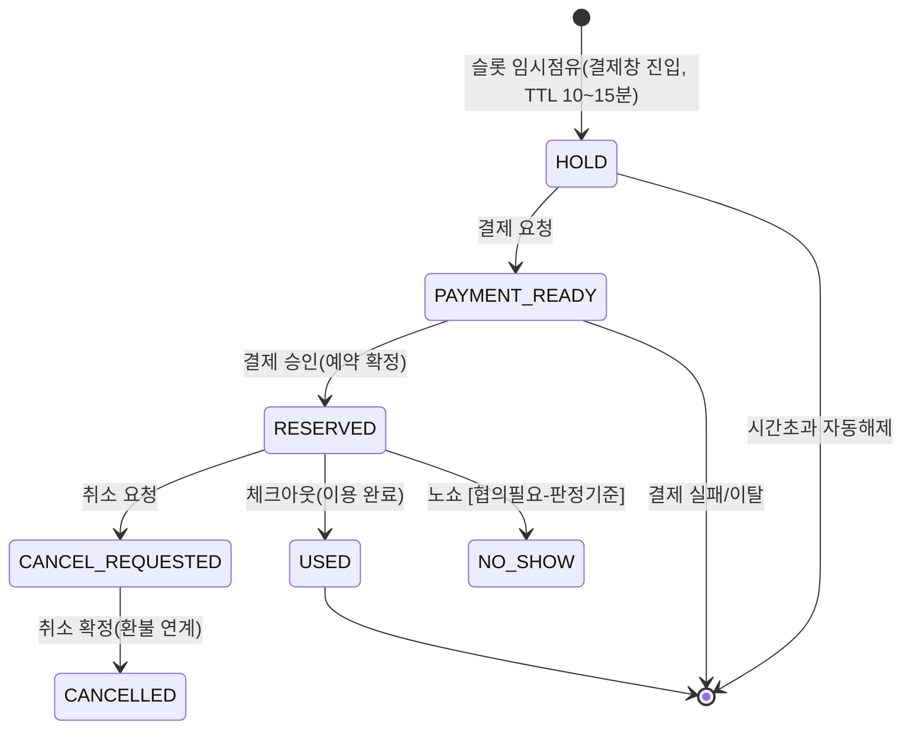

# 🔄 업무 흐름 / 상태 정의서 (기획·PM·전체)

> '이음' 핵심 업무의 **상태값과 전이 규칙** 정의. 화면 문구·뱃지·필터 기획의 기준이 됩니다.
> `[협의필요]` = 발주처(큐어) 확정 대기 항목. 상태 코드값은 API에 이 영문 그대로 노출됩니다.

---

## 1. 파트너 입점 흐름


- **승인 전(PENDING)에는 로그인 불가** — "승인 대기 중" 안내.
- 반려 시 사유가 기록되며 재신청 가능.

## 2. 계정 상태 (공통)

| 상태 | 의미 |
| --- | --- |
| `PENDING` | 가입/승인 대기 |
| `ACTIVE` | 정상 |
| `REJECTED` | 승인 반려(파트너) |
| `SUSPENDED` | 이용 정지 |
| `WITHDRAWN` | 탈퇴 (개인정보는 보존기간 후 파기/익명화 `[협의필요: 보존기간]`) |

## 3. 고택/객실 등록 흐름 (운영자 주도, 기획서 기준)

```
파트너 선택 → 고택 생성 → 객실 생성 → 기본정보 → 객실설정(비품/시설)
→ 운영시간 → 요금 설정 → 정책·안내 → 게시(ACTIVE)
```
- 고택/객실 상태: `DRAFT`(작성중) → `ACTIVE`(노출) ↔ `HIDDEN`(숨김) / `SUSPENDED`(중지)
- 요금 수정 권한(파트너 직접 vs 운영자 승인) `[협의필요]`

## 4. 예약 상태머신


- **중복 예약 방지**: 결제 진행 중 슬롯은 다른 사용자가 잡을 수 없음(Redis 임시점유) — 미결제 시 자동 풀림.
- 예약 채널: `EEUM`(자체) / `PHONE`(전화 수기) / `NAVER`·`OTA`(후순위 연동).

## 5. 결제 상태

| 상태 | 의미 |
| --- | --- |
| `READY` | 결제 요청 생성(토스 결제창) |
| `APPROVED` | 승인 완료 |
| `CANCELLED` / `PARTIAL_CANCELLED` | 취소 / 부분취소 |
| `FAILED` | 실패 |
- 결제 금액은 **서버가 재계산**(요금캘린더+인원+옵션-할인) — 화면 표시 금액과 다르면 결제 거부.
- 영수증·결제내역은 마이페이지에서 조회(기획서 기준).

## 6. 환불 흐름 `[협의필요 多]`

```
취소 요청 → 환불 정책 적용(위약금 계산) → 환불 승인 → PG 취소 실행 → 완료
```
- 상태: `REQUESTED → APPROVED/REJECTED → PROCESSING → COMPLETED/FAILED`
- `[협의필요]` **8시간 환불정책의 해석**(체크인 8시간 전? 결제 후 8시간?), 위약금의 플랫폼/파트너 배분율 → 확정 전까지 **수동 운영**(관리자 승인 방식)으로 시작.

## 7. 정산 흐름 (파트너별)

```
결제완료(정산 후보) → 체크아웃(정산 예정) → 무환불 확정+D+5(정산 확정) → 입금(지급 완료)
```
- 상태: `EXPECTED → CONFIRMED → PAID` (+`HELD` 보류)
- 정산금 = 판매금 − 환불 − 카드수수료 − 플랫폼수수료 − 부가세 `[협의필요: 수수료율, 타OTA 합산 여부, D+5 확정]`
- 1차는 **수동 확정 방식**(관리자가 검토 후 확정), 자동화는 정책 확정 후.

## 8. 문의(게시판형 CS Q&A) 상태 (2026-06-16 구현)

- **답변상태(`ANS_STTS_CD`)**: `PENDING`(답변 대기) → `ANSWERED`(답변 완료). 운영자 답변 등록 시 전이, 답변 전부 삭제 시 `PENDING` 복귀.
  - 작성자 글 수정/삭제는 **`PENDING`(답변 전)** 에만 가능 — 답변 완료 후 수정 시도는 `409 INQUIRY_LOCKED`.
- **게시상태(`PSTG_STTS_CD`)**: `NORMAL`(정상) ↔ `BLINDED`(블라인드 — 운영자 부적절글 비노출). 권한 `INQR_MODER`.
- **공개범위(`PRVT_PST_YN`)**: 비밀글(Y)은 작성자·운영자만 열람, 비인가자에겐 목록 마스킹 + 상세 404. 유형이 예약/결제/계정이면 기본 비밀.

## 9. 데이터 삭제 정책 (전사 공통)
- 모든 삭제는 **숨김 처리(soft delete)** — 즉시 물리삭제 없음. 일정 유예기간 후 배치로만 파기/익명화.
- 개인정보 보존기간은 법/계약 기준으로 확정 필요 `[협의필요]`.
