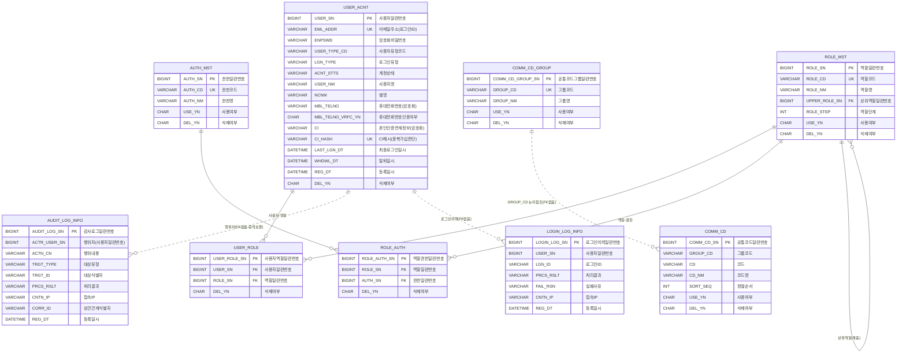
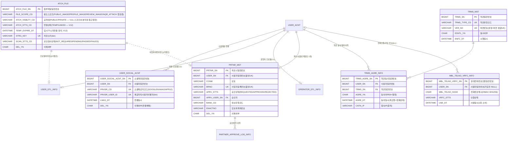
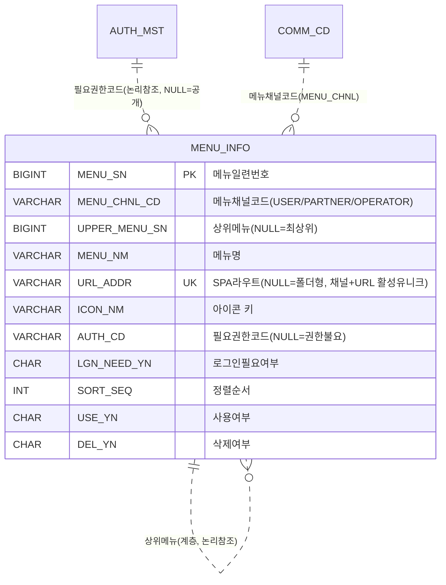
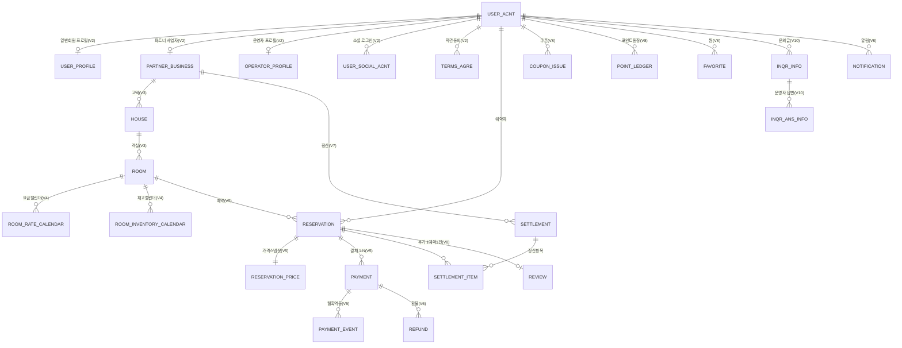

# 🗂 이음(Eeum) ERD — 현재 DB 기준 (테이블명 V6·V7 반영)

> **정본 주의**: 아래 §1 현재 ERD의 테이블명은 V6·V7 개명을 반영한 신 이름입니다. 단, §2 "목표 ERD"는 도메인 레벨 논리명(미구현 포함)입니다. **현재 실제 스키마 정본은 [db-schema-current.md](../db-schema-current.md)를 우선하세요.**
> **기준**: 개발서버 MySQL `eeum` 스키마에 실제 적용된 Flyway V1 (2026-06-10) + **V2·V3·V4 (2026-06-11)**
> V3는 기준 시드(테이블 없음 — 공통코드/역할/권한/약관 데이터), V4는 메뉴(§1-3).
> 명명: 행안부 공공데이터 공통표준용어 기반. 상세 컬럼 정의는 [DDL 문서] 참고.
> Notion 팁: 아래 코드블록 언어를 `mermaid`로 두면 다이어그램으로 렌더링됩니다.

---

## 1. 현재 ERD (V1 — 9개 테이블)

### 설계 포인트
- **soft delete + 활성 유니크**: 모든 업무 테이블은 `DEL_YN`으로 논리삭제. 유니크 제약은 "활성 행"에만 적용되는 **생성컬럼**(예: `ACTV_EML_ADDR`)으로 걸어, 탈퇴 후 같은 이메일 재가입이 가능 (위 다이어그램에선 생성컬럼 생략).
- **감사컬럼 공통**: `REG_DT`(등록일시) `RGTR_SN`(등록자) `MDFCN_DT`(수정일시) `MDFR_SN`(수정자) `DEL_YN` — 전 테이블 동일 (다이어그램엔 일부만 표기).
- **RBAC 데이터 주도**: 역할/권한이 전부 테이블 데이터 — 코드에 역할명 하드코딩 없음. 관리자 체계가 바뀌어도 데이터만 수정.
- **로그 테이블 FK 생략 (의도)**: 탈퇴·삭제 후에도 감사 증적을 보존해야 하므로 `AUDIT_LOG_INFO`/`LOGIN_LOG_INFO`는 FK를 걸지 않음.
- **CI는 해시로 유니크**: 본인인증 CI는 암호화 저장(랜덤 IV라 매번 다른 암호문) → 중복가입 판단은 별도 `CI_HASH`(SHA-256)에 유니크.

---

## 1-2. V2 추가 ERD (계정 상세 — 9개 테이블, 2026-06-11 적용)

> 소셜계정 / 프로필(회원·운영자) / 파트너사업자·승인이력 / 약관·동의 / 첨부파일 / 전화번호인증. codex 교차검토 3차 통과.
> `ATCH_FILE` 엔티티는 통합 첨부 보강(V11 권한·쿼터 / V12 연결 생명주기 `ATCH_STTS_CD`·`TEMP_EXPIRE_DT` / V13 공개성 `ATCH_VISBLTY_CD`)을 반영했다. 상세 누적 변경은 §2 향후 V 표 참고.

### V2 설계 포인트
- **약관은 활성유니크 미적용**: 법적 증적이라 삭제 후에도 같은 유형+버전 재사용 금지 (평문 UNIQUE).
- **약관동의는 append-only 이력**: 동의/철회 모두 행 추가, `AGRE_DT` 기준 최신 행이 현재 상태. IP/UA/채널 증적 포함.
- **전화인증 1회 소비 모델**: `USE_DT` 기록 + 외부거래ID 유니크 + 상태↔완료시각 CHECK.
- **전화번호 해시는 HMAC-SHA256**: 탐색공간이 작아 단순 SHA-256은 사전대입 위험 (`USER_ACNT.MBL_TELNO_HASH`도 동일).
- **파트너 승인 정합성 CHECK**: 상태별 필수 컬럼 조합을 DB가 강제(REQUESTED=흔적없음/APPROVED=승인자·일시/REJECTED=+반려사유). 이력은 `PARTNER_APPROVE_LOG_INFO` 보존.
- **opaque 식별자(소셜 sub, 저장소키, 외부거래ID)는 bin collation** — 대소문자 구분.

---

## 1-3. V4 메뉴 ERD (2026-06-11 적용)

> SPA 3종(사용자/파트너/운영자) 동적 메뉴 — `GET /menus/list?menuChnlCd=` 로 제공. codex 교차검토 반영.

- 메뉴 채널은 사용자유형(USER_TYPE)과 **별개 개념** — "어느 SPA에 노출되는가" (장기적으로 1:1이 아닐 수 있음).
- 모순 차단 CHECK: 비로그인 메뉴(`LGN_NEED_YN='N'`)에 권한코드 부여 불가.
- 노출 규칙은 앱(서비스)에서: 로그인/권한 필터 + 조상 체인 전체 노출 가능해야 자식 노출(고아 제거).

---

## 2. 전체 목표 ERD (도메인 레벨 — 향후 V3~V8)

### 핵심 흐름
**파트너 → 고택 → 객실 → (요금/재고 캘린더) → 예약 → 결제(토스) → 정산**

| 마이그레이션 | 범위 | 시점 |
| --- | --- | --- |
| V1 ✅ | 공통코드 / 계정 / RBAC / 로그 | **적용 완료** |
| V2 | 소셜계정·프로필·파트너·운영자·약관·파일 | account/auth 개발 시 |
| V3 | 고택·객실·이미지·비품·시설 | 상품 개발 시 |
| V4 | 요금제·요금/재고 캘린더·휴무 | |
| V5 | 예약·가격스냅샷·결제·결제이벤트 | |
| V6 | 환불·환불정책 | 큐어 정책 확정 후 |
| V7 | 정산 | 수수료율 확정 후 |
| V8 | 쿠폰·포인트·후기·찜·알림 | |
| **V10 ✅** | **문의(게시판형 Q&A) — `INQR_INFO`·`INQR_ANS_INFO`** | **적용 완료(2026-06-16)** |
| **V11 ✅** | **파일 업로드 권한(`FILE_UPLOAD` — 운영자·파트너)·쿼터 인덱스(`ATCH_FILE`)** | **적용 완료(2026-06-18)** |
| **V12 ✅** | **통합 첨부 토대 — `ATCH_FILE` 연결 생명주기(`ATCH_STTS_CD` TEMP/LINKED·`TEMP_EXPIRE_DT`·`LINKED_DT`)·인덱스** | **적용 완료(2026-06-18)** |
| **V13 ✅** | **첨부 공개성 — `ATCH_FILE.ATCH_VISBLTY_CD`(PUBLIC/PRIVATE, 하이브리드)** | **적용 완료(2026-06-18)** |
